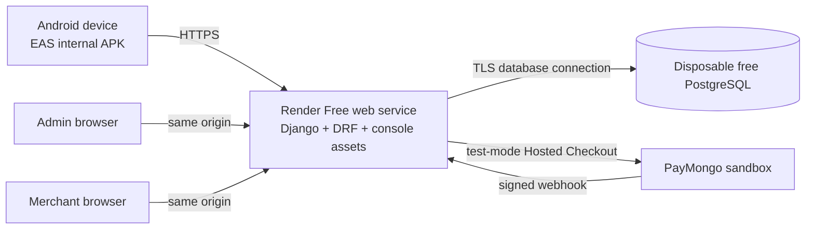

# Comprehensive Repository Audit and Academic Demo Plan — 2026-10-19

**Decision:** **ACADEMIC DEMO HOLD** and **PRODUCTION HOLD**

**Audited revision:** `master` at `bc8407c`

**Scope:** active Django modular monolith, admin and merchant consoles, Expo/React Native customer application, shared contracts, tests, data, Render configuration, EAS/APK distribution, and retained legacy assets where they affect the active path

**Change boundary:** this audit updates documentation only. It did not deploy, create cloud resources, alter provider accounts, rotate credentials, build an EAS artifact, or mutate a hosted database.

## 1. Executive assessment

MetroDrip has a substantial implementation, but the complete system is **not ready for a hosted academic demonstration today**. The active Django backend, mobile commerce flows, and much of both staff consoles exist. TypeScript, Expo configuration health, JavaScript export, most client invariants, and the backend test suite provide a useful base.

Three immediate release blockers must be contained before public deployment or meaningful release acceptance:

1. `render.yaml` runs `seed_demo_staff` on every build. That command publishes fixed administrator and merchant passwords in source and resets the accounts to those passwords on every deployment.
2. The Render Blueprint defines the consoles on a separate static origin, while the console code uses relative same-origin login and API URLs. The static service has no API proxy, and the backend has no production CORS origin configured. Read-only probes of the existing public console confirm that hosted staff workflows cannot reach Django through the current path.
3. The current default-branch client suite is red. The new development proxy calls a missing `_send_json` method, its test harness assumes a `python` executable that is absent in this environment, and the browser state suite no longer intercepts the same-origin API path correctly.

The recommended zero-cost academic route is:

Use Render Free PostgreSQL only for a scheduled, synthetic-data demonstration created inside its 30-day lifetime. If the demonstration must remain available longer without periodic database replacement, select and test Neon Free as an external PostgreSQL alternative before implementation. No paid upgrade is part of either route.

## 2. Evidence boundary and method

### 2.1 Inspected sources

- Repository governance: `AGENTS.md`, `AIO.md`, Planner Expert, Coding Companion, and current Project Guidelines.
- Active backend: `metrodrip_backend/` settings, URLs, models, migrations, permissions, views, checkout/payment adapter, management commands, and tests.
- Staff clients: `web/` login, session handling, admin/merchant pages, development server, and browser tests.
- Customer client: `App.js`, `mobile/`, `src/services/`, Expo configuration, package metadata, and client tests.
- Delivery: `render.yaml`, tracked environment/database artifacts, branch history, dependency manifests, and official provider documentation.
- Historical `services/`, `gateway/`, and Compose assets were treated as reference code, not the approved deployable system.

### 2.2 Executed checks

| Check | Result | Evidence boundary |
|---|---|---|
| `npx tsc --noEmit` | **PASS** | Static TypeScript check only. |
| `npx expo-doctor` | **PASS — 18/18** | Expo dependency/configuration diagnostics; not a native-device test. |
| `npx expo install --check` | **PASS** | Declared Expo dependency compatibility. |
| `npx expo config --type public` | **PASS** | Resolved API origin was HTTPS and Android cleartext was disabled for the deployed configuration. |
| `npx expo export --platform all` | **PASS** | Android, iOS, and web JavaScript bundles exported to an isolated temporary directory; this is not an APK build. |
| Django test suite | **81 run: 77 passed, 4 PostgreSQL-only skipped** | Current code passed on temporary SQLite. The main audit environment used Python 3.14.6/Django 6.1.1 rather than the declared Django 5.2.16, so this does not replace target-runtime or PostgreSQL acceptance. |
| `npm run test:client` | **FAIL — 128 passed; harness could not spawn `python`** | Default command is not portable in this Linux environment. |
| `PYTHON=python3 npm run test:client` | **FAIL — 137/148 passed; 11 failed** | All failures exercise development-server POST/error paths that call missing `_send_json`. |
| `npm run test:browser` | **FAIL after 64 layout checks passed** | Responsive layout checks passed; state-flow suite timed out because same-origin API requests escaped its mock routing. |
| `npm audit --omit=dev` | **36 findings: 24 high, 12 moderate, 0 critical** | Automated fixes require incompatible Expo/React Native changes; no upgrade was attempted. |
| `render.yaml` YAML + current official JSON Schema | **PASS** | Structural validation only. Render account/API validation and application were not performed. |
| Public endpoint probes | **Mixed** | Backend health endpoints and console root returned `200`; the console-origin API returned `404`, and backend responses did not allow the console origin through CORS. Their service-to-repository/deployed-SHA association is unverified. A health `200` is not database readiness. |

### 2.3 Not verified in this audit

- A connected Render database, service logs, deployed commit SHA, environment values, database age, or backup/restore.
- Current migrations, rollback, concurrency, and full tests on the declared Python version plus PostgreSQL. Prior dated evidence remains useful but is not a current rerun.
- PayMongo test checkout, actual webhook delivery/retry, enabled payment rails, native browser return, or any real-money behavior.
- EAS signing, cloud build, APK download, clean installation, upgrade installation, physical-device flows, TalkBack, or iOS behavior.
- Real browser-to-Django staff workflows after the topology is repaired.

## 3. Implemented capability inventory

### 3.1 Administrator console

| Capability | Current state |
|---|---|
| Staff login/logout and opaque bearer token | Implemented in Django and browser client; hosted path is broken by deployment topology. |
| Dashboard counts, recent users, audit summary | Implemented. |
| User search/filter/export, creation, suspension, reactivation, role change | Implemented, but newly created users receive an unusable password and cannot complete setup. |
| Shipping-zone read/update | Implemented. |
| Role summary and audit browse/export | Implemented with coarse role checks and incomplete mutation coverage. |
| Profile/preferences, password change, session revocation | Implemented; password rotation does not use the same validators as signup. |
| Custom roles, platform settings, reset delivery, MFA | Explicitly unavailable (`501`, `503`, or fail-closed UI). |

### 3.2 Merchant console

| Capability | Current state |
|---|---|
| Dashboard sales/order/stock summaries | Implemented; stock summary overstates sellable quantity while reservations exist. |
| Product/category create and edit, activation, initial stock, restock, movements | Implemented; created default variants do not satisfy the mobile app's fabricated size/color/fit selection contract. |
| Order list/detail/export and fulfillment transitions | Implemented. |
| Review read/reply/moderation | Implemented. |
| Shipment status, shipping-zone management, banner CRUD/scheduling | Implemented. |
| Analytics, courier booking, address eligibility | Explicitly unavailable. |
| Tenant isolation | Not implemented. Every merchant role currently operates the same global store. |

### 3.3 Customer mobile application

| Capability | Current state |
|---|---|
| Navigation/onboarding, signup/login, catalog, search/filter/sort | Implemented. |
| Product variants, wishlist, cart, approved reviews and review eligibility | Implemented, with variant compatibility and fabricated media/rating defects. |
| Server-authoritative checkout, COD, idempotency and stock reservation | Implemented. |
| Payment capability discovery and Hosted Checkout polling | Implemented, but Payment Details can reselect unavailable rails and app-kill recovery is incomplete. |
| Order history/detail/tracking | Implemented. |
| In-app notifications and unread state | Implemented; push notifications are not implemented and load failures look like an empty inbox. |
| Profile/address management | Implemented with response/UI inconsistencies. |
| Session, cart and pending-payment persistence | Not implemented; state is memory-only. |
| Installable distribution | Android identifiers exist, but no reproducible EAS/APK profile or verified build exists. |

### 3.4 Backend and shared integrations

- Django 5.2/DRF modular monolith with identity, catalog, order/payment, fulfillment, content, and staff boundaries.
- SQLite for local work and PostgreSQL through `DATABASE_URL` for the target environment.
- Opaque token authentication, persisted coarse roles, server-owned pricing, transactional inventory reservations, order snapshots, idempotent checkout, signed webhook handling, reconciliation, and a payment transition ledger.
- COD and PayMongo Hosted Checkout integration for configured GCash, Maya, and card rails.
- WhiteNoise is configured for Django static assets, but the root `web/` consoles are not yet packaged or routed through Django.

## 4. Findings and required remediation

Severity definitions: an **Immediate blocker** must be contained before public deployment or further release acceptance. A **Major** finding breaks an essential workflow, truthfulness, security boundary, or reproducible deployment and also blocks academic **GO** when it belongs to the section 5 scope. A **Moderate** finding can be excluded from the declared single-store academic path only when documented and hidden from the presentation.

### 4.1 Immediate blockers

| ID | Finding and impact | Evidence | Remediation and acceptance |
|---|---|---|---|
| B-01 | Deployments create or reset privileged users to public fixed passwords. Any repository reader can obtain administrator or merchant access. | `render.yaml:13`; `identity/management/commands/seed_demo_staff.py:10-49` | Remove the command from deployment. Disable/rotate any deployed affected accounts through an authorized operation. Retain protected one-time provisioning. **Accept when** a fresh deploy neither creates nor changes privileged users and the old constants fail. |
| B-02 | Deployed staff consoles cannot reach Django. The separate static origin submits relative `/login/` and `/api/*` paths to itself; there is no proxy, and production CORS is empty. | `render.yaml:47-59`; `web/Registration/AppLogin.js`; `web/js/user-session.js`; Django settings CORS block | Serve console assets and routes from Django on the API origin (recommended), or configure one explicit API base plus an exact CORS allowlist. **Accept when** deployed-browser login, one admin mutation, one merchant mutation, logout, `401`, and `403` all pass. |
| B-03 | Current default-branch client/browser regression gates fail. This removes confidence in the commit that changed API routing. | `web/dev_server.py`; `tests/client/devServer.test.mjs`; `tests/browser/run-console-layout.mjs` | Implement `_send_json`, support required proxy methods, make Python discovery portable, and repair browser mocks for same-origin API calls. **Accept when** all 148 client tests and both browser suites pass without changing tracked files. |

### 4.2 Major cross-system, backend and console findings

| ID | Finding and impact | Required disposition |
|---|---|---|
| SYS-01 | `render.yaml` pins `archim` (`6f537ce`) while the audited/default branch is `master` (`bc8407c`), and two backend hostnames are referenced. The deployed code and canonical callback/API origin are ambiguous. | Choose one branch, service, database, and canonical HTTPS URL; align mobile, console, callbacks, CSRF/CORS, docs, and record the deployed SHA. |
| SYS-02 | `web/dev_server.py` defaults to a public Render backend. Local developers can unknowingly send credentials/test data to a hosted system. | Default to `http://127.0.0.1:8000`, print the selected target, and require explicit opt-in for remote targets. |
| SYS-03 | `/health/` always returns `200` without a database check. Render can report a healthy application whose database is disconnected or unmigrated. | Keep liveness cheap and add bounded `/ready/` database/schema readiness. Test both disconnected and healthy states. |
| SYS-04 | Migration and privileged seeding are mixed into the build command. Free Render web services do not support the paid pre-deploy phase. | Remove all privileged seeding. For this free academic service, use only backward-compatible migrations in the build or a guarded startup wrapper; rehearse failure/rollback on a disposable database. |
| SYS-05 | The Blueprint and canonical docs disagree: the file declares a Python service, static service, and database, while the approved architecture says one web service plus one database. The static service also omits explicit `autoDeployTrigger: off`. | Implement the chosen same-origin topology and update config/docs together. Until CI exists, keep every service auto-deploy disabled. |
| SYS-06 | There is no CI workflow. Current manual evidence cannot prevent another default-branch regression. | Add zero-cost CI for Django/PostgreSQL tests, migrations, Node tests, typecheck, Expo checks, browser integration, Blueprint schema validation, and secret scanning. |
| SYS-07 | Render Free PostgreSQL expires after 30 days, has a 14-day grace period, 1 GB capacity, and no managed backups or pooling. | Treat it as disposable demo infrastructure, create it inside the presentation window, and rehearse logical export/restore. Use a tested no-expiry free external database if continuous availability is required. |
| SYS-08 | The repository tracks `.env`, `db.sqlite3`, and `db.sqlite3.baseline.bak`. The current `.env` key is public Expo configuration, but the pattern invites environment drift and accidental disclosure; database files can be stale or contain synthetic/private data. | Commit `.env.example`, ignore machine-specific `.env`, classify the database fixtures, and retain them only if tests require sanitized fixtures. Inspect exact staged/outgoing files before publication. |
| SYS-09 | Production dependency audit reports 24 high and 12 moderate findings, with automatic fixes requiring incompatible framework changes. | Record the temporary academic-demo exception, then test a supported Expo SDK/React Native upgrade in a separate branch. Do not force an incompatible audit fix. |
| SYS-10 | The repository has no safe non-debug production catalog/demo-data seed. `seed_consoles` is debug-only and destructive in places; the unsafe staff seed must be removed. | Add a repeatable synthetic catalog/order fixture that never creates credentials, is explicitly gated to demo environments, and is tested for idempotency. |
| ADM-01 | Admin-created accounts have unusable passwords, while reset/setup delivery is unimplemented. The UI reports account creation as success even though the person cannot sign in. | For the demo, either implement single-use setup tokens with a verified no-cost delivery channel or remove account creation from the presented scope and use protected operator provisioning. |
| AUTH-01 | Authorization is role-only. Multiple merchant users share global products, orders, and reviews with no store membership/ownership boundary. | Adopt and label a **single-store academic model** for this release, limiting merchant provisioning; otherwise implement Store/membership ABAC and cross-merchant denial tests. |
| AUTH-02 | Profile email updates can create case variants that bypass signup's case-insensitive check, making case-insensitive login ambiguous. | Normalize email at model/API boundaries and add a case-insensitive database constraint plus collision-cleanup migration. |
| AUTH-03 | Admin inheritance differs between server, shared session logic, and merchant UI. | Choose whether administrators may enter merchant workflows, then align permission checks and tests. |
| DATA-01 | Merchant inventory shows physical quantity rather than `quantity - reserved_quantity`, overstating sellable stock during pending checkout. | Return on-hand, reserved, and available values separately and base availability/low-stock alerts on available stock. |
| OPS-01 | Audit rows use mutable actor text and many merchant mutations are not recorded. | Add stable actor ID, result, target, request/correlation ID, and security-relevant mutation coverage. |
| UX-01 | Analytics, courier booking, address eligibility, custom roles, platform settings, password reset, and MFA are intentional stubs. | Hide or visibly label every deferred area. Do not call the whole repository fully functional; demo only the accepted essential workflow set. |
| SCALE-01 | Several staff lists are hard-capped without pagination metadata. | Add bounded pagination before data volume grows; acceptable to defer for a small synthetic demo dataset if declared. |

### 4.3 Major mobile and end-to-end findings

| ID | Finding and impact | Required disposition |
|---|---|---|
| MOB-01 | Merchant product creation produces an attribute-free variant, while mobile fabricates Black/White, S/M/L, and Regular options and requires an exact match. Merchant-created products can appear but cannot be added to cart. | Treat backend variants as the only option source; support a truthful default variant or capture attributes in the merchant form. Add merchant-create → mobile-cart → checkout integration. |
| MOB-02 | Authentication, cart, and pending payment state are memory-only. Process death loses recovery context. Mobile logout clears memory without revoking the 30-day server token. | Store tokens in `expo-secure-store`, non-sensitive cart/pending order state in persistent storage, restore through an owned profile/order read, and call server logout before local clear. |
| MOB-03 | There is no `eas.json`, EAS project identifier/owner, Android `versionCode`, iOS `buildNumber`, cloud build, or installation evidence. | Add an internal `preview` APK profile, non-secret EAS metadata, build-number policy, EAS environment API URL, and a physical-device runbook. |
| MOB-04 | Backend returns to an HTTPS page that only says to close the tab. It has no validated app link. Payment Details also reintroduces every hardcoded payment method after capability filtering. | Persist the pending order; provide a validated custom-scheme action or verified App/Universal Links; pass/refetch capabilities and disable unavailable rails. |
| MOB-05 | Guests enter the entire checkout form and receive a late `401` only when the protected order request is sent. | Gate Checkout before delivery data, route to login, and restore the same cart/destination afterward. |
| MOB-06 | Password reset is unavailable, and a network/non-API error is displayed as successful delivery. | Implement a real single-use flow or disable it truthfully. Never display success without backend confirmation. |
| MOB-07 | Product screens use a repeated local/placeholder image and a hardcoded `4.6 / 23 reviews`, contradicting live product/review data. | Render validated backend media with a local fallback and derive rating/count from the same review response. |
| MOB-08 | Owned cancellation exists in Django but is absent from the mobile service/UI, leaving unpaid attempts and reservations active until expiry. | Add confirmed, idempotent cancellation for eligible unpaid orders and verify reservation release. |
| MOB-09 | Shipping zones are hardcoded in the app and can drift from database activation/fees. | Add a public active-zone endpoint or freeze and verify an explicit demo contract. |
| MOB-10 | Checkout requires an email field that is not sent; profile response/UI fields, category ID assumptions, and notification error states also disagree. | Remove fabricated requirements/ID assumptions, align response contracts, and distinguish error from empty states. |
| MOB-11 | Legacy product/wishlist/header controls lack complete labels, selected state, focus semantics, and 44×44 targets. | Run physical Android font-scaling/TalkBack checks and repair essential-path issues before presentation. |
| PAY-01 | Payment capabilities report rails as available whenever two secrets exist; they do not prove provider/account activation. | Add an explicit verified rail allowlist and make the capability response and checkout validation share it. |

## 5. Academic demonstration contract

The word “complete” must refer to the following declared academic workflow, not every menu item in the repository.

### 5.1 Essential presentation scope

1. A customer signs up or signs in, browses real seeded catalog data, selects a real variant, adds it to the cart, and completes a COD order.
2. Stock reservation/commit is reflected consistently in customer availability and merchant inventory.
3. The customer sees confirmation, order history, and tracking from the same hosted database.
4. A merchant signs in, creates or edits a product/variant, updates inventory, views the customer order, and performs an allowed fulfillment transition.
5. An administrator signs in, views users/audit/shipping configuration, performs one approved user action, and is denied merchant/admin actions when the role contract says so.
6. A PayMongo **test-mode** Hosted Checkout success, cancel/failure, delayed webhook, and duplicate webhook are demonstrated if sandbox credentials and enabled rails are available. If the provider is unavailable, the presentation must explicitly label this part unverified; COD remains the live fallback.
7. The Android APK is installed directly on a physical device and uses the canonical HTTPS backend.

### 5.2 Explicitly deferred from the academic gate

- Multi-store/multi-merchant tenancy; the accepted demo model is one shared store.
- Production durability, high availability, autoscaling, long-term retention, and production payment activation.
- App Store/Play Store publication; distribution is direct internal APK.
- Direct card handling, refunds, courier booking, analytics, custom roles, MFA, push notifications, and any page still visibly marked unavailable.
- Password reset/account creation may be omitted from the live script unless a verified delivery/setup flow is implemented.

### 5.3 Assumptions

| ID | Assumption | Reason | Impact if wrong | Status |
|---|---|---|---|---|
| A-01 | A scheduled demonstration window is known at least seven days ahead. | Render database must be created/rehearsed within its lifetime. | Select Neon Free and retest connectivity if continuous availability is required. | Assumed |
| A-02 | Synthetic data and test-mode payments only are acceptable. | Academic purpose and no-paid constraint. | Privacy/legal/payment scope must be reassessed for real users or money. | Assumed |
| A-03 | Android direct APK installation is acceptable; store listing is not required. | Avoid paid store enrollment and review delay. | A store release needs a separate funded distribution plan. | Assumed |
| A-04 | One shared MetroDrip store is acceptable for the presentation. | Current data model has no tenant boundary. | Multi-merchant claims remain blocked until ABAC is built. | Assumed |
| A-05 | An authorized owner can access Render, Expo/EAS, and PayMongo test accounts. | Live verification cannot be completed from source alone. | Deployment/provider phases remain blocked without those accounts. | Blocked until owner assigned |

## 6. Implementation and remediation plan

Estimates are focused engineering effort, not calendar promises. External account approval, free build queues, and provider activation are waiting time and are excluded. Phases may overlap only after their dependencies are satisfied.

| Phase | Work and owner | Depends on | Exit evidence | Estimate |
|---|---|---|---|---|
| P0 — Contain and decide | Remove automatic privileged seeding; plan authorized live account rotation; choose canonical branch/origin/database; accept single-store academic scope. Owners: security/platform/product. | None | Known credentials fail; signed decision record; no secret values in diff/logs. | 0.5–1 day |
| P1 — Restore a green baseline | Repair dev proxy JSON/method handling and portable Python selection; repair browser mocks; add CI; rerun client/browser/Django/TypeScript/Expo checks. Owners: full stack/QA. | P0 origin decision | All local gates green on a clean tree; CI protects default branch. | 1.5–3 days |
| P2 — Integrate one hosted origin | Package/route consoles through Django, or implement the approved explicit API/CORS alternative; align canonical URL, callbacks, CSRF, branch, SHA, readiness, and Blueprint. Owners: backend/DevOps. | P0, P1 | Deployed browser proves staff positive and negative flows; `/ready/` detects DB loss. | 2–4 days |
| P3 — Repair essential data/identity contracts | Default/attribute variant contract; sellable inventory; email uniqueness; protected staff provisioning; safe synthetic catalog fixture; decide admin account-creation presentation path. Owners: backend/web/data. | P1 | Merchant-created product completes customer COD workflow; identity negative cases pass. | 2–4 days |
| P4 — Make mobile recovery truthful | Secure token persistence/revocation; cart/pending-order restore; early auth gate; cancellation; capability allowlist; return link; real images/ratings; zone contract; essential accessibility. Owners: mobile/backend/QA. | P2, P3 | Force-stop recovery, logout revocation, COD and provider-state tests pass on device. | 3–5 days |
| P5 — Deploy free demo stack and APK | Provision chosen free database; migrate and seed synthetic non-credential data; deploy exact SHA; build EAS preview APK; install and record checksum/build URL. Owners: DevOps/mobile. | P2–P4 | Hosted readiness, deployed SHA, APK install, canonical API, restore rehearsal, usage/expiry checks. | 1–2 days plus queues |
| P6 — Rehearse and release academic demo | Run full checklist twice, pre-warm/cold-start exercise, reset fixtures, rehearse provider fallback and rollback, capture evidence. Owners: QA/presenter. | P5 | Two clean rehearsals; no open blocker; signed demo go/no-go. | 1–2 days |

Expected focused total: approximately **10–19 engineer-days**, reducible in calendar time by parallel web/mobile work after P0/P1. Do not compress P0, deployed integration, APK installation, or rehearsal.

## 7. Free-tier hosting and testing strategy

| Layer | Recommended no-cost choice | Limits and controls | Decision |
|---|---|---|---|
| API + consoles | One Render Free Python web service, with Django serving API and staff assets on one origin | Sleeps after 15 minutes; wake can take about one minute; 750 free instance-hours/workspace/month; ephemeral filesystem; no free shell/pre-deploy phase | Recommended |
| Database, scheduled demo | Render Free PostgreSQL | 1 GB; expires at 30 days; 14-day grace then deletion; no managed backups/pooling | Recommended only for a scheduled disposable demo |
| Database, longer-lived demo | Neon Free PostgreSQL | Current free allowance is 1 GB/project and 100 compute-unit hours/project/month; external TLS/latency and Render egress behavior must be tested | Conditional alternative; architecture decision required |
| Database alternative | Supabase Free PostgreSQL | Free projects may pause for inactivity and need wake/restore planning | Secondary alternative |
| Android build | Expo EAS Free internal/preview APK | Current free allowance lists up to 15 Android and 15 iOS builds/month, low priority, 45-minute timeout; add `android.buildType: apk` or internal distribution | Recommended |
| Payment | Existing PayMongo test mode only | Account/test keys and enabled rail verification required; no real charge | Required for online-payment demo, otherwise label unverified |
| CI | GitHub Actions for the repository within its free/public allowance, or an equivalent existing free runner | Pin versions, cache safely, no provider secrets on untrusted PRs | Recommended |
| Monitoring | Render logs + scripted `/health/`, `/ready/`, and smoke checks | No paid APM; redact tokens and personal data | Recommended |

Do not use local SQLite on Render: the free web filesystem is ephemeral. Do not add a paid worker, cron service, Redis/Key Value, disk, autoscaling, or database upgrade. Request-driven expiry/reconciliation must remain correct without background infrastructure.

## 8. Verification and functionality checklist

Every checked item needs a dated artifact: command output, deployed SHA, redacted screenshot/video, database assertion, or provider event ID. A screenshot alone does not prove the backend state.

### 8.1 Repository and security gate

- [ ] `git status --short` is clean and the deployed SHA matches the approved SHA.
- [ ] No deployment command creates, resets, or logs privileged credentials.
- [ ] Former fixed credentials receive `401`; authorized staff use rotated one-time-provisioned credentials.
- [ ] Secret scan covers the exact staged tree and outgoing history without printing values.
- [ ] Full Django, client, browser, typecheck, Expo, migration, and Blueprint CI gates pass.
- [ ] Dependency advisory exception and upgrade follow-up are recorded.

### 8.2 Backend and database gate

- [ ] Fresh PostgreSQL migration succeeds; `makemigrations --check` is clean.
- [ ] Upgrade and rollback boundary are rehearsed on disposable data.
- [ ] `/health/` proves process liveness; `/ready/` fails on DB loss and passes on the expected schema.
- [ ] Synthetic catalog seed is idempotent and creates no login credentials.
- [ ] Logical export restores successfully to a second disposable database.
- [ ] Concurrent checkout cannot oversell and duplicate idempotency keys cannot duplicate orders.
- [ ] Logs redact tokens, secrets, addresses, provider payload secrets, and password material.

### 8.3 Admin and merchant gate

- [ ] Correct staff login reaches the canonical backend; invalid credentials and wrong roles are rejected.
- [ ] Logout revokes the token; replay returns `401`.
- [ ] Admin lists/searches users, performs the selected user action, updates a shipping zone, and sees an audit row.
- [ ] Merchant creates a valid default or attributed variant, restocks it, and sees on-hand/reserved/available values.
- [ ] Merchant receives the customer order and performs only an allowed fulfillment transition.
- [ ] Browser network log contains no static-origin `/api/*` `404`, CORS, CSRF, or mixed-origin drift.
- [ ] Every deferred menu item is hidden or clearly labeled unavailable.

### 8.4 Customer APK gate

- [ ] Clean checkout builds the `preview` APK with the canonical HTTPS API URL.
- [ ] APK checksum, EAS build identifier/URL, version, and deployed backend SHA are recorded.
- [ ] Clean install and cold start pass on at least one physical Android device; a second device/OS version is strongly preferred.
- [ ] Signup/login survives force-stop; logout revokes the backend token.
- [ ] Guest checkout redirects to login before collecting delivery data and restores the cart.
- [ ] The exact merchant-created product can be selected, added to cart, and ordered.
- [ ] COD confirmation, history, tracking, merchant order view, and inventory state agree.
- [ ] Cancelled unpaid order releases its reservation and repeated cancellation is safe.
- [ ] App background, app kill, offline/reconnect, expired token, and cold backend recovery are truthful.
- [ ] TalkBack, large text, focus order, labels, selected state, contrast, and 44×44 targets pass on the essential path.

### 8.5 PayMongo test-mode gate

- [ ] Capability response exposes only explicitly verified test rails.
- [ ] The same allowlist blocks unsupported rails at checkout and in Payment Details.
- [ ] Successful Hosted Checkout does not mark paid from redirect alone; signed webhook/provider reconciliation does.
- [ ] Cancel/failure, delayed webhook, duplicate event, invalid signature, mismatched amount/currency, and timeout paths pass.
- [ ] HTTPS return can reopen the owned pending order without embedding a secret or trusting a caller-selected customer/order.
- [ ] COD still works while PayMongo is unavailable.

## 9. Deployment and demonstration readiness plan

### T-minus 7 days

1. Freeze the approved demo SHA and record database creation/expiry dates.
2. Confirm free usage allowance, account access, canonical domains, test keys, and no billing-requiring selections.
3. Run migrations, safe synthetic seed, restore rehearsal, all CI gates, and an EAS APK build.
4. Install on presentation devices and execute the full integration checklist.

### T-minus 1 day

1. Re-run readiness, staff/customer smoke tests, one COD order, and one PayMongo test flow if in scope.
2. Reset only synthetic demo records through the rehearsed safe process.
3. Verify database lifetime, EAS artifact availability, laptop/device chargers, network, and a backup hotspot.
4. Prepare a clearly labeled recording/screenshots as a fallback; never present fallback media as a live provider success.

### T-minus 30 minutes

1. Pre-warm the backend and verify `/ready/` after the free-service cold start.
2. Sign in with rotated demo accounts, then clear client state and return to the starting screen.
3. Confirm PayMongo test mode, catalog stock, presentation order IDs, and device clock/network.
4. Keep the deployed SHA, APK checksum, and rollback target visible to the operator.

### Live sequence

1. Merchant creates/updates a product and inventory.
2. Customer uses the physical-device APK to browse that product and complete COD.
3. Merchant receives and advances the order.
4. Customer shows history/tracking.
5. Admin demonstrates the approved user/shipping/audit action.
6. Run the PayMongo sandbox path only after clearly stating it is test mode.

### Rollback and recovery

- Application regression: use Render's retained prior deploy only if its schema is compatible; otherwise redeploy the known-good SHA.
- Database migration failure: stop the demonstration, restore the rehearsed logical dump to a fresh disposable database, repoint only after verification, and do not improvise destructive rollback.
- Provider outage: keep the order pending/failed truthfully, show COD, and use the labeled prerecorded provider evidence.
- Backend cold start/network outage: wait for bounded readiness, retry idempotently, and never submit a second checkout with a new idempotency key merely because the UI timed out.
- After presentation: revoke/rotate demo staff credentials, retain only approved synthetic evidence, and delete test secrets/artifacts according to provider policy.

## 10. Risk register

| ID | Risk | Likelihood | Impact | Early signal | Mitigation | Owner | Status |
|---|---|---|---|---|---|---|---|
| R-01 | Known privileged credentials are reachable on a public deploy. | High | High | Seed command or old login still works | Complete P0 before any public demo; rotate/disable affected accounts | Security/platform | Open blocker |
| R-02 | Console and API origins drift or CORS fails. | High | High | `/api` 404, preflight failure, wrong hostname | Same-origin target and deployed-browser tests | Web/backend | Open blocker |
| R-03 | Free backend cold start interrupts the live flow. | High | Medium | First request exceeds client/presenter patience | Pre-warm, bounded retry/pending UI, backup network | Platform/presenter | Open |
| R-04 | Free database expires or cannot be restored. | High | High | Expiry warning, restore not rehearsed | Create inside demo window; record expiry; export/restore; select Neon if long-lived | Data/platform | Open decision |
| R-05 | Merchant-created product remains unpurchasable. | High | High | No matching mobile variant | One variant contract and cross-client integration test | Mobile/backend | Open blocker |
| R-06 | App kill strands a pending payment or token. | High | High | State disappears after force-stop | Secure/persistent restore and owned order reconciliation | Mobile/backend | Open |
| R-07 | Provider rail/test account is unavailable. | Medium | Medium | Capability/create request rejected | Explicit allowlist; verify ahead; COD fallback; label provider gap | Payments | Open external |
| R-08 | Dependency fix destabilizes Expo. | Medium | High | Forced audit fix changes Expo/RN major versions | Separate supported upgrade with export/device regression | Mobile | Accepted for current demo pending work |
| R-09 | Single-store behavior is presented as tenant isolation. | Medium | High | Two merchants see same resources | Declare one-store scope or implement ABAC before claim | Product/security | Scope-controlled |
| R-10 | Manual-only checks regress again. | High | Medium | Default branch turns red | Add CI before deployment | QA/platform | Open |

## 11. Go/no-go rule

Change **ACADEMIC DEMO HOLD** to **GO** only when B-01 through B-03 are closed, the essential scope in section 5 passes on the deployed SHA and installed APK, the database is inside its verified availability window, and every external gap is either passed or explicitly removed from the presentation claim. Production remains **HOLD** because the selected free services do not provide production durability, availability, or operational guarantees.

## 12. Current official service references

- [Render free-instance limits](https://render.com/docs/free)
- [Render Blueprint specification](https://render.com/docs/blueprint-spec)
- [Render deployment lifecycle](https://render.com/docs/deploys)
- [Expo installable APK configuration](https://docs.expo.dev/build-reference/apk/)
- [Expo EAS pricing and quotas](https://expo.dev/pricing)
- [Neon Free 1 GB/project announcement](https://neon.com/blog/neon-free-plan-1-gb-per-project)
- [Supabase free-project pausing](https://supabase.com/docs/guides/platform/free-project-pausing)
