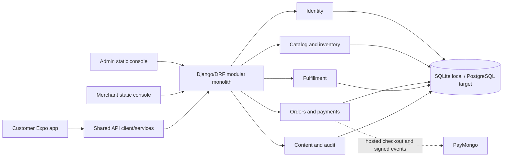

# QA Audit and Implementation Report — 2026-10-11

**Release decision:** **HOLD**

**Local delivery status:** **Completed** for the authorized audit, prioritized reversible fixes, and local regression checks. **Blocked** or **Not Started** checks are called out below and are not represented as production evidence.

**Scope:** active Django modular monolith, administrator console, merchant console, Expo/React Native customer application, shared client services, local SQLite data, dependencies, and review-only Render configuration.

## 1. Executive summary

MetroDrip is materially safer and more truthful after this pass. The highest-impact completed work prevents bearer credentials from crossing API origins, makes online payment availability fail closed, removes fabricated checkout and review data, requires a delivered purchase before a review can be submitted, moderates new reviews, normalizes and validates new accounts, hides inactive catalog data, bounds wishlist query growth, restores valid Expo assets, limits cleartext Android traffic to explicit local development, and improves core mobile accessibility states and targets.

All authorized local regression gates pass:

- **75/75 Django tests** on the developer environment.
- **75/75 Django tests** on a disposable Python 3.14.5 environment with the declared Django 5.2.16 and DRF 3.18.1 requirements. The Blueprint declares Python 3.14.3, so this is close target-stack evidence, not exact Python patch evidence.
- **148/148 client contract and invariant tests**.
- **0 TypeScript errors**.
- **64/64 mocked Chromium console layout/state cases**, plus dialog Escape, focus-return, and Tab-containment checks.
- Successful Expo web export: **676 modules, 40 assets, 1,515,929-byte JavaScript bundle**, valid favicon, and **7,440,035 total exported bytes**.
- SQLite integrity check `ok`, zero foreign-key violations, and zero records in the audited duplicate/orphan/negative-value categories.
- Django production diagnostics pass when supplied production-like security settings.

The system is **not production-ready**. Release remains on hold because real PostgreSQL migration/rollback/concurrency and restore behavior, PayMongo sandbox/webhook delivery, physical Android/iOS behavior, screen-reader use, browser-to-Django staff journeys, production-like load, and connected Render behavior were not observed. The local database also has pending migrations and was intentionally not mutated.

### Status legend

| Status | Meaning in this report |
|---|---|
| **Completed** | Implemented or audited and backed by the stated local evidence. |
| **In Progress** | A safe improvement was applied, but a larger compatibility or verification track remains. |
| **Blocked** | Requires an unavailable target, credentials, external account, protected action, or production decision. |
| **Not Started** | Deferred because prerequisite target evidence is missing or the work is outside this authorized local pass. |

### Delivery dashboard

| Workstream | Status | Result |
|---|---|---|
| System discovery and active-architecture audit | **Completed** | Active path confirmed as `metrodrip_backend/`; `services/` and `gateway/` remain historical comparison assets. |
| Admin and merchant local UI audit | **Completed** | All 64 mocked responsive/state cases pass; real API-backed browser journeys remain blocked. |
| Customer mobile source, contract, and web-export audit | **Completed** | Core commerce defects fixed; client tests, type check, Expo config, and web export pass. |
| Security and data-integrity remediation | **Completed** | High-impact auth transport, review trust, signup, catalog visibility, and local data checks pass. |
| Dependency remediation | **In Progress** | Critical count reduced from 1 to 0; 29 high and 9 moderate advisories remain in the Expo/React Native dependency graph. |
| PostgreSQL, external-provider, physical-device, and Render verification | **Blocked** | Required environments, credentials, and protected deployment authority were not available or authorized. |
| Production-like load and cold-start benchmark | **Not Started** | Requires the target PostgreSQL/provider/Render-like environment to produce meaningful latency evidence. |

## 2. QA goals and testing plan

### Quality goals

1. Preserve authoritative server ownership of identity, price, stock, payment state, order IDs, and review verification.
2. Fail closed when identity, payment capability, or provider state is uncertain.
3. Keep customer, merchant, and admin workflows truthful in default, loading, empty, error, disabled, and retry states.
4. Protect object ownership and persisted-role boundaries without trusting caller-selected identifiers.
5. Preserve data and migration reversibility; do not alter the existing local database during audit work.
6. Reduce request, query, asset, and dependency overhead where measurable without an architectural rewrite.
7. Separate executed local evidence from native, PostgreSQL, provider, and deployment acceptance.

### Test strategy and acceptance

| Area | Approach | Acceptance used in this pass |
|---|---|---|
| Backend correctness | Django unit/integration tests, negative inputs, migration drift, deploy diagnostics | All tests pass; no model drift; production-like check has no warnings. |
| Client/API contracts | Node source-contract tests and TypeScript | All tests pass; no type errors; public calls omit credentials; cross-origin auth is rejected. |
| Staff consoles | Headless Chromium at 320, 390, 768, and 1280 CSS pixels with mocked APIs | No horizontal overflow; required state and dialog keyboard checks pass. |
| Mobile build/config | Expo dependency check, resolved public config, web export | Compatible dependencies; valid assets; configured remote API is HTTPS; remote cleartext disabled; export succeeds. |
| Security | Source/config review, negative auth tests, dependency audit, secret-pattern inventory | No private-key material found; test credentials stay in test files; critical npm advisories reach zero. |
| Database | Read-only SQLite integrity, referential/orphan, duplicate, stock, and money checks | Integrity `ok`; zero audited invalid records; no database mutation. |
| Performance | Request-path inspection, query-count regression, export asset/bundle measurement | Wishlist query count stays bounded; duplicate home fetch removed; asset count reduced and current bundle measured. |

## 3. System audit results

### Active system map

The active deployable backend is the single Django process under `metrodrip_backend/`. The five services and gateway are retained historical assets and were not treated as the current production topology.

### 3.1 Administrator console

**Completed locally**

- Persisted-role backend permission classes protect administrator routes; caller-selected role text is not the authorization source.
- Mocked browser coverage exercises loading, default, empty, partial, permission, failed-write, retry, and narrow layouts.
- Add User dialog keyboard behavior passes Escape dismissal, focus return, and Tab containment.
- Console pages remain responsive across the four tested viewport widths.

**Open**

- Store/permission-level ABAC, MFA, and recent-authentication gates are not implemented.
- Browser tests mock APIs; a real browser-to-Django administrator journey was not executed.
- Password-reset delivery intentionally returns `503` and generates no token because a delivery workflow is not configured.

### 3.2 Merchant console

**Completed locally**

- Merchant/admin role boundaries and operational order/inventory APIs are covered by the Django regression suite.
- Mocked browser checks cover responsive layouts, operational states, write failures, retry behavior, and permission outcomes.
- Existing order/payment truthfulness controls remain intact; no current-pass changes were made to the merchant web source.

**Open**

- Store-scoped merchant tenancy is not represented; the current boundary is coarse persisted role.
- Real API-backed browser workflows, PostgreSQL locking, courier/provider integrations, and production data volumes remain unverified.

### 3.3 Customer mobile application

**Completed locally**

- Checkout now consumes the backend `methods[].available` capability contract rather than a mismatched field and keeps online rails disabled when capability discovery fails.
- Checkout no longer embeds demo contact details, a hard-coded loopback request, a fixed total, or a randomly fabricated order ID.
- Empty-cart, unavailable-payment, loading, validation, and retry-safe paths are explicit.
- Public catalog, category, and review reads no longer attach a bearer token.
- A bearer token or caller-supplied authorization header cannot be sent to an origin other than the configured API origin.
- Product reviews begin empty, show honest loading/error/empty states, and never convert a failed API write into local success.
- Core Home, Shop, filters, product cards, reviews, cart, footer navigation, checkout, and account controls gained accessible labels, roles, selected/disabled states, live regions, and larger interaction targets where needed.
- Unsupported delivery, returns, sizing, review-history, and policy claims were removed or rewritten as capability-dependent statements.

**Open**

- Physical Android/iOS layout, touch behavior, keyboard behavior, deep links, external hosted-checkout return, and screen-reader behavior remain unverified.
- The web bundle is still 1.52 MB; vector-icon fonts are the largest visible asset group.

### 3.4 UI/UX quality

Core workflows now expose truthful loading, empty, error, retry, disabled, and moderation states. A recurring audit theme was false certainty: sample profile data, a fabricated order number, prefilled review social proof, “verified” badges derived from caller data, and unsupported policy copy. Those were removed or bound to server evidence.

Automated evidence is strongest for responsive staff-console layout and source-level mobile state contracts. Color contrast, screen-reader announcements, dynamic text sizing, switch control, and full touch-target acceptance still need real devices and assistive technology.

### 3.5 Functional and integration behavior

- Catalog details, variants, and stock now exclude inactive products/variants.
- Wishlist writes reject missing, invalid, and inactive product references.
- Review submission requires an authenticated customer and a delivered/completed order that actually contains the product.
- Duplicate review submissions for the same customer, order, and product return a conflict response.
- New reviews enter `pending`; only `approved` reviews are publicly listed.
- Verified-review badges are derived from delivered order-line ownership in a batched query.
- Signup lowercases and trims email, checks duplicates case-insensitively, runs Django password validators, and handles a same-email insert race.
- Payment capability mapping uses the active backend schema and fails online payment methods closed.

### 3.6 Security assessment

**Improved controls**

- Same-origin enforcement for bearer credentials.
- Public read requests explicitly omit authorization.
- Delivered-purchase verification and moderation for reviews.
- Review submission throttle of 5/day per effective Django throttle identity.
- Stronger signup password and email handling.
- Production email backend no longer defaults to console output.
- Android cleartext disabled whenever the configured API is remote HTTPS.
- One critical npm advisory removed.

**Residual security risks**

- Django's default local-memory throttling is process-local; two Gunicorn workers do not share counters. It is a useful speed bump, not a global abuse-control guarantee.
- Coarse role checks do not provide store-level or fine-grained permissions, MFA, or step-up authentication.
- Thirty-eight npm advisories remain. `npm audit fix --dry-run` proposes zero safe changes; reported direct fixes include breaking/incompatible Expo and React Native version changes.
- `figma_node.json` contains expired signed-URL metadata issued 2026-09-10 and expired 2026-09-17. It is no longer usable but should be removed or regenerated as repository hygiene.
- The tracked `.env` contains only `EXPO_PUBLIC_API_URL`, and the audited value uses HTTPS. It contains no server secret, but tracking environment files increases future disclosure risk.
- PayMongo-like keys found by pattern matching are confined to two payment test modules and are fixtures, not confirmed live credentials.

### 3.7 Database audit

The audit used read-only access to the existing SQLite file. It did not run migrations or write repair data.

| Check | Result |
|---|---:|
| SQLite `integrity_check` | `ok` |
| Foreign-key violations | 0 |
| Case-insensitive duplicate email groups | 0 |
| Orphan wishlist items | 0 |
| Invalid review customer/product/order references | 0 / 0 / 0 |
| Invalid stock rows (negative or reserved over quantity) | 0 |
| Orders with negative audited money fields | 0 |

Model drift is clean (`makemigrations --check --dry-run`: no changes), but the developer database has unapplied catalog, content, fulfillment, and identity migrations. Applying them is a data-changing action and was intentionally deferred. Fresh disposable migration and `collectstatic` checks succeeded earlier in this audit, but PostgreSQL forward/rollback, constraints, query plans, and concurrency remain unverified.

### 3.8 Performance and optimization

- Wishlist product hydration changed from one product lookup per row to one batched lookup. The regression test loads five items in no more than four total requests to the database.
- Home removed a duplicate product request, reducing that mount path from two product-list requests to one.
- Font imports now load only the seven used font faces. Expo export assets decreased from **66 to 40** (**39.4% fewer assets**).
- Public catalog calls omit unnecessary bearer-header construction and credential transport.
- The current web export is **7,440,035 bytes**, including a **1,515,929-byte** JavaScript bundle.

No production-like API latency, memory, CPU, throughput, cold-start, or PostgreSQL query-plan benchmark was run. Those metrics would be misleading on the local SQLite/mock environment.

## 4. Defect and risk register

| ID | Severity / priority | Finding and impact | Resolution or required control | Status |
|---|---|---|---|---|
| QA-SEC-01 | High / P0 | Bearer or caller authorization could follow an explicit absolute URL to another origin. | Resolve URLs, allow only HTTP(S), and reject authenticated cross-origin requests; tests cover both token sources. | **Completed** |
| QA-PAY-01 | High / P0 | Checkout read a non-existent capability shape and could present unavailable online rails. | Map `methods[].available`; fail online methods closed and retain COD fallback. | **Completed** |
| QA-TRUST-01 | High / P0 | Reviews included fabricated social proof, auto-approval, caller-selected orders, and weak “verified” logic. | Empty honest state, delivered-line ownership, pending moderation, duplicate guard, approved-only publication, and throttle. | **Completed** |
| QA-UX-01 | High / P0 | Checkout shipped demo identity, fixed totals, hard-coded loopback behavior, and a random pre-server order ID. | Removed fabricated data and bound flow to cart, account, capability, and server response state. | **Completed** |
| QA-ID-01 | High / P0 | Signup accepted weak passwords and handled email identity inconsistently. | Normalize email, case-insensitive check, Django password validation, atomic save, duplicate-race response. | **Completed** |
| QA-CAT-01 | Medium / P1 | Inactive product details, variants, stock, and wishlist targets could remain visible. | Apply active-product/variant filters and validate wishlist targets. | **Completed** |
| QA-PERF-01 | Medium / P1 | Wishlist hydration was N+1 and Home made a duplicate product request. | Batched lookup plus query regression; remove duplicate Home fetch. | **Completed** |
| QA-MOB-01 | High / P0 | Expo referenced missing default assets and Android globally allowed cleartext. | Use existing branded asset; dynamic config allows HTTP only for explicit loopback development. | **Completed** |
| QA-A11Y-01 | Medium / P1 | Core mobile controls lacked roles, labels, selected/disabled state, live regions, or reliable target size. | Added semantics and target improvements across core commerce/account paths. Physical AT acceptance still required. | **In Progress** |
| QA-OPS-01 | Medium / P1 | Production-like settings used console email and failed deployment diagnostics. | Development remains console-only; non-debug defaults to SMTP configuration; deploy check passes. Actual delivery remains unconfigured. | **Completed** |
| QA-DEP-01 | Critical / P0 | npm audit reported one critical dependency advisory. | Safe package-lock updates removed the critical finding. | **Completed** |
| QA-DEP-02 | High / P1 | 29 high and 9 moderate transitive advisories remain. | Plan an Expo/React Native SDK upgrade as a separate compatibility project; do not use the audit's breaking forced changes. | **In Progress** |
| QA-DB-01 | High / P0 | The current local database has unapplied migrations. | Back up and rehearse forward/rollback on disposable PostgreSQL before an authorized target migration. | **Blocked** |
| QA-DB-02 | High / P0 | PostgreSQL locking, deadlocks, constraints, restore, and query plans are not evidenced. | Run target-engine migration, concurrency, integrity, backup, and restore gates. | **Blocked** |
| QA-RBAC-01 | High / P1 | Admin/merchant authorization is coarse role-based, without store tenancy, MFA, or recent-auth. | Define permission/tenancy model and add step-up controls before privileged production use. | **Not Started** |
| QA-THROTTLE-01 | Medium / P1 | Abuse counters are process-local under multiple Gunicorn workers. | Use a production-appropriate shared limiter or edge control after infrastructure approval. | **Blocked** |
| QA-EXT-01 | High / P0 | PayMongo sandbox/webhook and native hosted-return behavior are unobserved. | Exercise signed retries, failures, interrupted returns, and provider capability in approved sandbox accounts/devices. | **Blocked** |
| QA-PLAT-01 | High / P0 | Free PostgreSQL lifecycle and backup limits do not meet durable commerce expectations. | Resolve retention/RPO/RTO with an authorized platform decision; no paid change was made. | **Blocked** |
| QA-PERF-02 | Medium / P2 | Web bundle remains 1.52 MB and vector-icon font assets dominate. | Inventory actual icon families and replace broad font imports without visual regressions. | **Not Started** |
| QA-META-01 | Low / P2 | Tracked Figma export contains expired signed-URL query metadata. | Regenerate a sanitized artifact or remove query parameters in a separately reviewed cleanup. | **Not Started** |

## 5. Implementation summary

### Backend

- `catalog/views.py`: active-catalog filters, review moderation and ownership checks, batched verified badges, honest zero rating, duplicate protection, validation, and throttling.
- `identity/views.py`: batched wishlist reads, active product validation, normalized email handling, password validation, and atomic signup duplicate handling.
- `metrodrip_backend/settings.py`: review throttle and development/production email-backend separation compatible with Django 5.2 and the developer environment.
- `identity/tests_mobile_backend.py`: new regression coverage for review trust, inactive catalog visibility, signup validation, and bounded wishlist queries.

### Customer client

- `src/services/apiClient.js`: validated URL resolution and same-origin authorization boundary.
- `src/services/orderService.js`: backend-owned payment capability discovery and fail-closed mapping.
- `src/services/productService.js`: explicitly public catalog reads.
- Checkout, reviews, Home, Shop, filters, cart, footer, account, signup, and product-card components: truthful state, fewer duplicate requests, accessibility improvements, and removal of demo/unsupported claims.
- `app.json`, `app.config.js`, and `src/theme/font.js`: valid assets, conditional local cleartext, HTTPS remote config, and narrower font loading.
- Client tests: capability, origin, public-request, review-truthfulness, and checkout-fabrication regressions.

### Dependencies

Safe lockfile updates were applied for `shell-quote`, Playwright, React Navigation, and `react-native-web` within current compatibility ranges. No forced audit fix or major Expo/React Native change was applied.

No administrator/merchant web-console source was changed in this pass; those surfaces were audited and regression-tested against their current mocked browser harness.

## 6. Testing and verification results

| Check | Observed result | Evidence boundary |
|---|---|---|
| Django developer-environment suite | **75 passed, 0 failed** | Local test DB; not PostgreSQL. |
| Disposable requirements stack | Python 3.14.5, Django 5.2.16, DRF 3.18.1; **75 passed** | Blueprint Python is 3.14.3; target patch not exact. |
| Django production diagnostics | **0 issues** with production-like secret/HSTS/host settings | Local config evaluation; not Render. |
| Model drift | **No changes detected** | Does not apply migrations. |
| Local migration plan | Pending migrations listed | Read-only; local database unchanged. |
| Client tests | **148 passed, 0 failed** | Source/service contracts; not native rendering. |
| TypeScript | **Pass, 0 errors** | Static type check. |
| Staff browser harness | **64 passed** + dialog keyboard checks | Chromium with mocked APIs and blocked external resources. |
| Expo dependency compatibility | **Dependencies are up to date** | Expo SDK 54 compatibility set. |
| Expo resolved config | HTTPS API; Android cleartext `false`; icon/splash/favicon resolve | Current tracked public environment only. |
| Expo web export | **Pass**, 676 modules, 40 assets, 1,515,929-byte JS | Web bundle only; no native binary. |
| npm audit | 0 critical, 29 high, 9 moderate | Advisories include build/toolchain paths; still release risk. |
| npm safe-fix dry run | 0 added, 0 removed, 0 changed | Remaining fixes require separate compatibility work. |
| Read-only SQLite audit | Integrity `ok`; all audited invalid counts zero | Existing local data only. |
| Render Blueprint policy | One free web + one free DB, previews/auto-deploy off, no forbidden paid topology keys | Static file assertion; nothing applied. |
| Secret/config inventory | No private-key file; public tracked env uses HTTPS; payment patterns limited to tests | Pattern/static inspection, not history-wide secret forensics. |
| Worktree whitespace | `git diff --check` passes | Re-run after documentation edits is required for final handoff. |

Expected non-failures observed during verification:

- Node warns that ESM files are reparsed because `package.json` does not set `type: module`; tests still pass.
- Expo reports unreadable historical `.pytest_cache` paths while exporting; the export succeeds and the generated directory was verified and removed.
- Django warns that `staticfiles/` is absent during tests; a disposable `collectstatic` run separately produced 599 files totaling 7,388,086 bytes.

## 7. Performance optimization results

| Metric | Before | After / current | Interpretation |
|---|---:|---:|---|
| Expo exported assets | 66 | 40 | **39.4% reduction** from explicit used-font imports. |
| Home product-list calls per initial path | 2 | 1 | Duplicate request removed by source inspection. |
| Wishlist query growth | Per-item product lookup | No more than 4 queries for 5 items | Bounded by automated regression; avoids linear hydration queries. |
| Web JS bundle | Not baselined | 1,515,929 bytes | Current measurement; further icon-family reduction is warranted. |
| Total web export | Not baselined | 7,440,035 bytes | Current measurement; not a native binary size. |

No p50/p95/p99 claims are made because the required PostgreSQL/Render/provider-like workload was unavailable.

## 8. Outstanding issues

### Blocked

- Disposable PostgreSQL forward migration, rollback, concurrency, query-plan, backup, and restore exercises.
- PayMongo sandbox capability, hosted checkout, signed webhook retry, failure, and reconciliation tests.
- Physical Android/iOS flows, deep-link/foreground recovery, screen readers, dynamic text, and device performance.
- Connected Render validation or deployment; no deployment was authorized.
- Shared/global abuse throttling and durable production database choice require infrastructure decisions.

### In progress

- Dependency remediation: critical exposure is removed, but 38 advisories remain.
- Mobile accessibility: semantics improved in core paths; physical assistive-technology acceptance remains.

### Not started

- Production-like load/cold-start benchmark.
- Fine-grained merchant/store authorization, MFA, and recent-auth controls.
- Password-reset delivery workflow.
- Vector-icon asset reduction and expired Figma signed-URL metadata cleanup.

## 9. Prioritized next steps

1. **P0 — Protect data before release:** take a verified backup, then rehearse every pending migration and rollback on disposable PostgreSQL; run ownership, money, stock, idempotency, and concurrent-checkout assertions.
2. **P0 — Verify real payment boundaries:** use an approved PayMongo sandbox to validate capability discovery, hosted redirects, signed duplicate/out-of-order webhooks, interrupted returns, and no false paid states.
3. **P0 — Run native acceptance:** test Android and iOS physical-device checkout, return/recovery, offline/error paths, keyboard, screen reader, dynamic text, and touch targets.
4. **P0 — Resolve release infrastructure:** decide how production PostgreSQL retention, backup, restore, and RPO/RTO will be met. Keep release on hold until resolved.
5. **P1 — Upgrade the mobile toolchain deliberately:** create an Expo/React Native compatibility branch, upgrade by supported SDK steps, then repeat all client, type, browser, export, and device gates. Do not use `npm audit fix --force` as a migration strategy.
6. **P1 — Strengthen privileged access:** design store-scoped permissions, MFA, recent-auth step-up, and shared abuse controls.
7. **P2 — Finish quality polish:** configure a real reset-delivery flow, reduce broad vector-icon font assets, sanitize the Figma export, and add real browser-to-Django staff journeys.

### Reference basis

- [Django 5.2 deployment checklist](https://docs.djangoproject.com/en/5.2/howto/deployment/checklist/) for production-setting diagnostics, HTTPS, secret handling, backups, email, static files, and the limits of per-process local-memory caching.
- [W3C WCAG 2.2 target-size guidance](https://www.w3.org/WAI/WCAG22/Understanding/target-size-minimum.html) for accessible pointer-target sizing and spacing.
- [npm audit documentation](https://docs.npmjs.com/cli/v11/commands/npm-audit/) for advisory and remediation-command interpretation.
- [OWASP Application Security Verification Standard](https://owasp.org/projects/asvs) as the security-control review framework; local checks in this report are not an ASVS certification.

## Completion statement

The authorized local audit, implementation, and regression cycle is **Completed**. No production deployment, real payment, destructive database operation, or live infrastructure change was performed. The repository is locally more secure, reliable, truthful, accessible, and efficient, but the release decision remains **HOLD** until the explicitly blocked target-environment gates pass.
